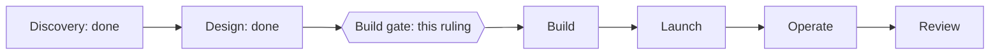

# P-001 — the Build gate

## 1. The ask

Approve the fair test's criteria, set its budget, and rule its seven open questions; the plan then freezes [specs/S-001.md].

**The proposer's recommendation:** proceed with option A, 60 pieces a kind — the plan passed review, and 60 is the smallest size seeing a 20-point gain about 4 times in 5 [reviews/S-001/plan.md] [specs/S-001.md:64] [specs/S-001.md:99].


*Text alternative: six phases in a row, Discovery, Design, Build, Launch, Operate and Review; Discovery and Design are done, and the Build gate between Design and Build is this ruling.*
Where the project stands in the six phases [docs/PROJECT.md]

## 2. The vision

More agent work should pass its check first time, changing only what a fair test shows helps, perhaps nothing [docs/PROJECT.md].
For you: fewer review rounds, better research, every agent's brief and AI model on record [docs/PROJECT.md].

## 3. What this phase taught us

Past tasks cannot be re-run faithfully, so the test uses new work as it arrives, done both ways [specs/S-001.md:10].
A held-back check on a different AI model judges both versions blind; about eight cards a kind, seen by you, confirm the judge [specs/S-001.md:10] [specs/S-001.md:116].
JOIN-UP: to be filled from the join-up review.

## 4. The plan for the next phase

A Check author blind to the changes writes each kind's held-back check; then pairs are collected, judged and analysed [specs/S-001.md:103].
Built work first, then plans, then research [specs/S-001.md:99].
The brief-and-model record (M3) is built beside the test [docs/PROJECT.md].

## 5. The risks

Slow: option A takes 60 to 121 weeks one kind after another, or 32 to 64 collected together [specs/S-001.md:94].
Plans and built work cannot enter until each piece's brief, start commit and model are recorded at dispatch [specs/S-001.md:15].
Two changes target causes worth at most about 11 to 19 points, so "not shown" is likely for them [specs/S-001.md:40].
Every judge is from the same provider as the work [specs/S-001.md:116].

## 6. Cost and limits

Option A: 732 runs, about 132 million tokens, within your existing AI plan unless you override it [specs/S-001.md:94] [decisions/questions/P-001-spend-ceiling.md].
Options B to D: 490, 266 or 1,040 runs [specs/S-001.md:95].
Through Design: 14 of your 100 test runs used [specs/S-001.md:66].
No cap on your time [docs/PROJECT.md].

## 7. Kill criteria

If no change clears chance, the result is "no change helps" and the project closes [decisions/questions/P-001-no-change-result.md] [docs/PROJECT.md].
You may stop any kind at its review point, on counts alone [specs/S-001.md:86].
A kept change that misses in real use is removed at the next rule review [docs/PROJECT.md].

## 8. What the owner is agreeing to

Criteria AC1 to AC11 as scenarios, frozen after this ruling [specs/S-001.md].
Your budget and your answers to the seven open questions [specs/S-001.md:194].
Build's and Launch's standard lines, all taken on [docs/PROJECT.md].
You are the user: no user representative step [docs/PROJECT.md].

## 9. Appendix: the phase record
<details>
<summary>The phase record</summary>

```milestones
```

The timeline prints no milestone lines for this project, whose work runs from a conversation (the gap the gate-record ruling addresses); the table gives each Design standard milestone with its record [decisions/questions/P-001-gate-record.md].

| Standard milestone | Record |
|---|---|
| Design-1 Done defined in real scenarios | The spec's criteria AC1 to AC11 [specs/S-001.md] |
| Design-2 How the pieces connect is mapped | The spec's join sheets J1 to J8 [specs/S-001.md] |
| Design-3 Every unknown has a test | Not recorded by the model; the test registered with its fallbacks [specs/S-001.md] |
| Design-4 Every fact is backed by evidence | The spec's facts relied on, each with its evidence [specs/S-001.md] |
| Design-5 The design fits together | Not recorded by the model; JOIN-UP |
| Design-6 A plan that passed review | The plan review passed at round 3 of 3; the freeze follows this ruling [reviews/S-001/plan.md] |

M2 shows no sprint yet: the plan's pull request has no reviewer record under its number; its check is the plan review [reviews/S-001/plan.md].
The blind Check author's reading list: PACK-STATUS.
Your rulings in this phase are recorded under decisions/questions [decisions/questions/P-001-gate-record.md].

</details>
