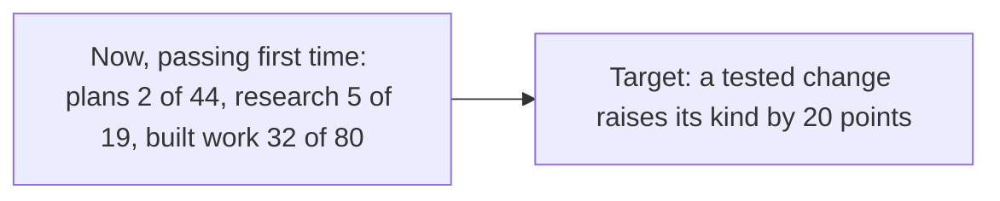
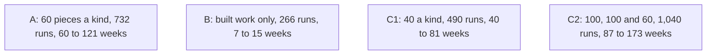
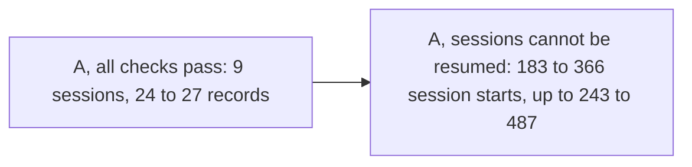

# P-001 — the Build gate

## 1. The ask

Approve the eleven criteria, in full in the proposal, choose a size on the gate card and answer the terms card; your ruling is then recorded and the plan freezes [docs/gates/P-001/build-gate-3-proposal.md] [reviews/S-001/plan.md:942] [reviews/P-001-build-gate/critic.md:164].

**The proposer's recommendation:** proceed with the gate card's option A, 732 runs — the plan passed review, and A tests every kind, as you ruled [reviews/S-001/plan.md:1] [reviews/S-001/plan.md:583] [decisions/questions/P-001-worst-work.md].


*Text alternative: six phases in a row, Discovery, Design, Build, Launch, Operate and Review; Discovery passed its gate, Design's plan passed review, and the Build gate between Design and Build is this ruling.*
Where the project stands [decisions/questions/P-001-design-gate.md] [reviews/S-001/plan.md:1]

## 2. The vision

More agent work passing its check first time, changing only what a fair test shows helps, perhaps nothing [docs/PROJECT.md:108] [docs/PROJECT.md:112].


*Text alternative: before and after. Now, plans passed their check first time 2 times in 44, research 5 in 19 and built work 32 in 80; the target is a rise of 20 points for the kind a tested change aims at. No result exists yet.*
Starting figures and the target [docs/PROJECT.md:111] [docs/PROJECT.md:108]

## 3. What this phase taught us

Past work cannot be re-run faithfully, so new work is done both ways [decisions/questions/P-001-e002-not-tested.md:12].
By your rulings, the judges' accuracy check was not run, and the secret marking sheets get their own private repository and sessions [decisions/questions/P-001-e002-not-tested.md:1] [decisions/questions/P-001-heldback-store.md:1].
No screens: the test has none [reviews/S-001/plan.md:927].

## 4. The plan for the next phase

The sizes below are the gate card's options [reviews/P-001-build-gate/critic.md:164].


*Text alternative: the sizes on the gate card. A, 60 pieces of each kind, 732 runs over 60 to 121 weeks; B, built work only, 266 runs over 7 to 15 weeks; C1, 40 of each kind, 490 runs over 40 to 81 weeks; C2, 100 pieces of research and of built work and 60 of plans, 1,040 runs over 87 to 173 weeks.*
The gate card's sizes, as the Critic checked them [reviews/P-001-build-gate/critic.md]

## 5. The risks

A real gain may be missed: about 4 in 5 at 60 pieces, about 1 in 2 for built work and research if the two versions often disagree, less if a judge errs [reviews/P-001-build-gate/critic.md:14] [reviews/P-001-build-gate/critic.md:17].
Smaller gains usually read "not shown" [reviews/P-001-build-gate/critic.md:18].
Secrecy from the sessions writing your cards may rest on instruction; a first check shows it; you decide [reviews/S-001/plan.md:897] [reviews/S-001/plan.md:963].
Plans and built work enter only if each piece's starting point is recorded (terms card) [reviews/S-001/plan.md:935].
For you to accept: four relays a kind, judging a week behind, and the secret word reaching a public record if a check fails [reviews/S-001/plan.md:913] [reviews/S-001/plan.md:916] [reviews/S-001/plan.md:920].
One reading list's comment is thin, a Reviewer's non-blocking note [reviews/44/reviewer.md:17].

## 6. Cost and limits

The ceiling is your AI plan; whether the runs fit is not known; work waits for the reset if not [decisions/questions/P-001-spend-ceiling.md:10] [docs/PROJECT.md:116].
Wake-ups are outside the budget; no cap on your time [reviews/S-001/plan.md:899] [docs/PROJECT.md:116].


*Text alternative: your part under option A. If every first check passes, 9 sessions to start and 24 to 27 records to pass; if sessions cannot be resumed after their machines are reclaimed, 183 to 366 session starts, or 243 to 487 if the Orchestrator's own session cannot either; a question comes to you before that kind opens.*
Your time under A [reviews/P-001-build-gate/critic.md]

## 7. Kill criteria

No change clears chance: "no change helps", and the project closes [docs/PROJECT.md:112].
A kept change missing in real use is removed [docs/PROJECT.md:113].
At every 20 runs and 16 weeks of each kind, you get the counts and say go on or stop [docs/gates/P-001/build-gate-3-proposal.md:24].

## 8. What the owner is agreeing to

The criteria, frozen, and your size [docs/gates/P-001/build-gate-3-proposal.md].
The terms card's eleven answers, and this pull request's reading lists [reviews/P-001-build-gate/critic.md:166] [reviews/44/reviewer.md:28].
Set-up: a private repository for the sheets, kept out of every other session [decisions/questions/P-001-heldback-store.md:12].
Build's and Launch's standard lines, all taken on [docs/PROJECT.md:60] [docs/PROJECT.md:72].
You are the user: no representative reads the proposal, despite its label [docs/PROJECT.md:166] [docs/gates/P-001/build-gate-3-proposal.md:3].

## 9. Appendix: the phase record
<details>
<summary>The phase record</summary>

```milestones
```

The gate check prints no milestone lines for this project, run from a conversation, as at the Design gate; the tables give each milestone with its record [docs/gates/P-001/design-gate-3-case.md:75].

| Milestone | Record |
|---|---|
| M2 A fair test of the changes is ready | Its plan passed review; yours to accept at this gate [docs/PROJECT.md:57] [reviews/S-001/plan.md:1] |
| Design-1 Done defined in real scenarios | The eleven criteria, checked side by side with the rest [reviews/S-001/plan.md:711] [docs/gates/P-001/build-gate-3-proposal.md] |
| Design-2 How the pieces connect is mapped | The join sheets, checked side by side [reviews/S-001/plan.md:711] |
| Design-3 Every unknown has a test | Not recorded by the model; seven first-use checks, untested until first use [reviews/S-001/plan.md:957] |
| Design-4 Every fact is backed by evidence | Cited lines exist and say what is claimed [reviews/S-001/plan.md:933] |
| Design-5 The design fits together | Not recorded by the model; the join-up review, no blocking difference [reviews/S-001/plan.md:939] |
| Design-6 A plan that passed review | PASS at round 3; the freeze follows this ruling [reviews/S-001/plan.md:1] [reviews/S-001/plan.md:942] |


*Text alternative: the check outcomes of the plan's last review: rounds 1 and 2 failed, round 3 passed, and the join-up review found no blocking difference.*
The plan's review [reviews/S-001/plan.md:3] [reviews/S-001/plan.md:939]

Rulings in Design: the plan rewritten twice, the sheets' own repository, the judges' check not run [decisions/questions/P-001-plan-stop.md] [decisions/questions/P-001-plan-stop-2.md] [decisions/questions/P-001-heldback-store.md] [decisions/questions/P-001-e002-not-tested.md].
Fixed after checks: cases 1 and 2, held by the gate Critic, and the standard lines reworded [reviews/P-001/_build-gate-1-critic.md] [reviews/P-001/_build-gate-2-critic.md] [reviews/P-001-standard-lines/critic.md].

Words used. Kind: plans, research or built work [docs/PROJECT.md:109].
Terms card: the questions asked beside the gate card, before the freeze [reviews/P-001-build-gate/critic.md:166].
Relay: a short message you pass from the secret side [reviews/S-001/plan.md:912].
First-use check: a check of the running, the first time it is used [reviews/S-001/plan.md:957].
Reading lists: the files each secret-side helper may read [reviews/44/reviewer.md:13].
The sessions writing your cards: the Orchestrator's and the Chief of Staff's [reviews/S-001/plan.md:897].

</details>
