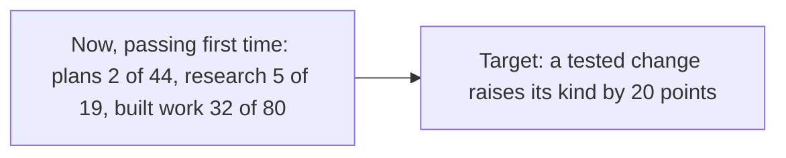
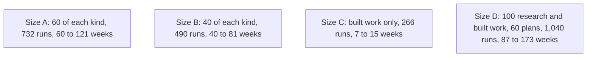
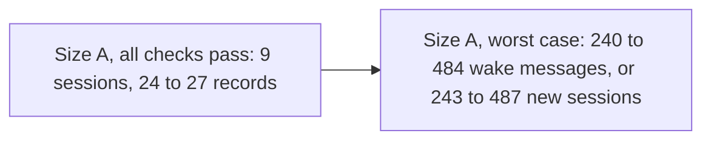
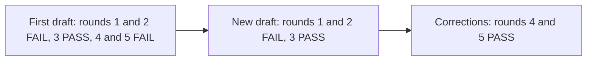

# P-001 — the Build gate

## 1. The ask

Approve the eleven criteria in the proposal, choose a size and answer the terms, on two cards that passed their check once cut down; the plan then freezes [docs/gates/P-001/build-gate-4-proposal.md] [reviews/P-001-build-gate/critic.md:360] [reviews/P-001-build-gate/critic.md:362] [reviews/S-001/plan.md:939].

**The proposer's recommendation:** proceed at size A, 732 runs — it tests every kind in turn [reviews/S-001/plan.md:1] [reviews/S-001/plan.md:535] [decisions/questions/P-001-worst-work.md].


*Text alternative: six phases in a row, Discovery, Design, Build, Launch, Operate and Review; Discovery passed its gate, Design's plan passed review, and the Build gate between Design and Build is this ruling.*
Where the project stands [decisions/questions/P-001-design-gate.md] [reviews/S-001/plan.md:1]

## 2. The vision

More agent work passing its check first time, changing only what a fair test shows helps, perhaps nothing [docs/PROJECT.md:108] [docs/PROJECT.md:112].


*Text alternative: before and after. Now, plans passed their check first time 2 times in 44, research 5 in 19 and built work 32 in 80; the target is a rise of 20 points for the kind a tested change aims at. No result exists yet.*
Starting figures and the target [docs/PROJECT.md:111] [docs/PROJECT.md:108]

## 3. What this phase taught us

Past work cannot be re-run faithfully, so new work is done both ways [decisions/questions/P-001-e002-not-tested.md:12].
By your rulings, the judges' consistency was not checked, and the secret sheets get their own repository and sessions [decisions/questions/P-001-e002-not-tested.md:1] [decisions/questions/P-001-heldback-store.md:1].
The join-up review closing Design found no blocking difference [reviews/S-001/plan.md:939].
No screens: the test has none [reviews/S-001/plan.md:927].

## 4. The plan for the next phase

Build's milestones: briefs and models on record, each change's result, what worked adopted, every slip corrected [docs/PROJECT.md:65] [docs/PROJECT.md:66] [docs/PROJECT.md:68] [docs/PROJECT.md:69].
The Builder runs the test, the Reviewer analyses it, the operating model's roles adopt what worked [docs/PROJECT.md:89] [docs/PROJECT.md:90].


*Text alternative: the plan's four sizes, weeks one kind after another. Size A, 60 pieces of each kind, 732 runs over 60 to 121 weeks; size B, 40 of each, 490 runs over 40 to 81 weeks; size C, built work only, 266 runs over 7 to 15 weeks; size D, 100 pieces of research and of built work and 60 of plans, 1,040 runs over 87 to 173 weeks. Tokens and chances for sizes other than A are on the gate card.*
The plan's sizes [reviews/S-001/plan.md:583] [reviews/S-001/plan.md:535] [reviews/S-001/plan.md:253] [reviews/S-001/plan.md:254] [reviews/S-001/plan.md:255] [reviews/S-001/plan.md:256]

## 5. The risks

A real gain may be missed: about 4 in 5 at 60 pieces under the library's assumption, about 1 in 2 for built work and research otherwise, less if a judge errs [reviews/P-001-build-gate/critic.md:17] [reviews/P-001-build-gate/critic.md:386].
For built work and research, smaller gains usually read "not shown" [reviews/P-001-build-gate/critic.md:272].
Secrecy from the sessions writing your cards likely rests on instruction; you decide after the first check [reviews/S-001/plan.md:897] [reviews/S-001/plan.md:963].
To accept: four relays a kind, judging a week or more behind, the secret word never reused [reviews/S-001/plan.md:913] [reviews/S-001/plan.md:916] [reviews/S-001/plan.md:921].
One reading list's comment is thin, a Reviewer's minor note [reviews/44/reviewer.md:17].

## 6. Cost and limits

The ceiling is your AI plan; if the runs do not fit, work waits for the reset [decisions/questions/P-001-spend-ceiling.md:10] [docs/PROJECT.md:116].
Wake-ups are outside the budget; no cap on your time; usage so far: not recorded [reviews/S-001/plan.md:899] [docs/PROJECT.md:116].


*Text alternative: your part under size A. If every first check passes, 9 sessions to start and 24 to 27 records to pass; if no session can wake itself, up to 240 to 484 wake messages, or if none can be resumed, up to 243 to 487 new sessions.*
Your time under size A [reviews/P-001-build-gate/critic.md:164] [reviews/S-001/plan.md:1019]

## 7. Kill criteria

No change clears chance: "no change helps", and the project closes [docs/PROJECT.md:112].
A kept change missing in real use is removed [docs/PROJECT.md:113].
At every token checkpoint and 16-week review point of each kind, you get the counts and say go on or stop [docs/gates/P-001/build-gate-4-proposal.md:24].

## 8. What the owner is agreeing to

The criteria, frozen, and your size [docs/gates/P-001/build-gate-4-proposal.md].
The terms card's answers, and pull request #44's reading lists [reviews/P-001-build-gate/critic.md:373] [reviews/44/reviewer.md:28].
Set-up: a private repository for the sheets, which you check is kept out of other sessions [decisions/questions/P-001-heldback-store.md:12].
Build's and Launch's standard lines, all taken on [docs/PROJECT.md:60] [docs/PROJECT.md:72].
You are the user: no representative reads the proposal, despite its label [docs/PROJECT.md:166] [docs/gates/P-001/build-gate-4-proposal.md:3].

## 9. Appendix: the phase record
<details>
<summary>The phase record</summary>

```milestones
```

The gate check prints no milestone lines for this project, run from a conversation, as at the Design gate; the table gives each milestone with its record [docs/gates/P-001/design-gate-3-case.md:75].

| Milestone | Record |
|---|---|
| M2 A fair test of the changes is ready | Its plan passed review; its pull request is open, so no sprint has merged; yours to accept at this gate [docs/PROJECT.md:57] [reviews/S-001/plan.md:1] |
| Design-1 Done defined in real scenarios | The eleven criteria, checked side by side with the rest [reviews/S-001/plan.md:711] [docs/gates/P-001/build-gate-4-proposal.md] |
| Design-2 How the pieces connect is mapped | The join sheets, checked side by side [reviews/S-001/plan.md:711] |
| Design-3 Every unknown has a test | Not recorded by the model; seven first-use checks, untested until first use [reviews/S-001/plan.md:957] |
| Design-4 Every fact is backed by evidence | The cited intake, runner and risk-paths lines exist and say what is claimed [reviews/S-001/plan.md:933] |
| Design-5 The design fits together | Not recorded by the model; the join-up review, no blocking difference [reviews/S-001/plan.md:939] |
| Design-6 A plan that passed review | The new draft's round 3 PASS, with two focused corrections passed at rounds 4 and 5; the freeze follows this ruling [reviews/S-001/plan.md:1] [reviews/S-001/plan.md:3] [reviews/S-001/plan.md:942] |


*Text alternative: the plan's ten review rounds. The first draft failed rounds 1 and 2, passed round 3, then failed the join-up review at round 4 and a focused review at round 5; the new draft failed rounds 1 and 2 and passed round 3; two focused corrections then passed at rounds 4 and 5.*
The plan's reviews [reviews/S-001/plan.md:3]

Rulings in Design: one focused review, then a rewrite with its own review; the sheets' own repository; the judges' check not run; the Build-gate cards cut down [decisions/questions/P-001-plan-stop.md] [decisions/questions/P-001-plan-stop-2.md] [decisions/questions/P-001-heldback-store.md] [decisions/questions/P-001-e002-not-tested.md] [reviews/P-001-build-gate/critic.md:360].
Fixed after checks: cases 1 to 3, held by the gate Critic; the cards, after three failed rounds and a cut-down redraft; the standard lines reworded [reviews/P-001/_build-gate-3-critic.md] [reviews/P-001-build-gate/critic.md:178] [reviews/P-001-standard-lines/critic.md].

Words used. Kind: plans, research or built work [docs/PROJECT.md:109].
Terms card: the plan's open questions, seven argued and four listed with the plan's answer [reviews/P-001-build-gate/critic.md:373].
Relay: a short message you pass from the secret side [reviews/S-001/plan.md:912].
First-use check: a check of the running, the first time it is used [reviews/S-001/plan.md:957].
Reading lists: the files each secret-side helper may read [reviews/44/reviewer.md:13].
The sessions writing your cards: the Orchestrator's and the Chief of Staff's [reviews/S-001/plan.md:897].

</details>
