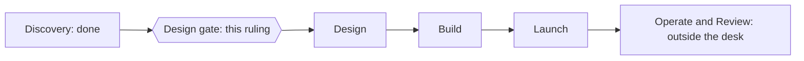

# P-001 — the Design gate

## 1. The ask

Move into Design, where a fair test of candidate changes is written down before anything runs [docs/PROJECT.md].

**The proposer's recommendation:** proceed — the brief passed its readiness check, the starting figures are checked, and you already ruled to go on with three unknowns open [reviews/P-001-ready/critic.md] [decisions/questions/P-001-after-the-count.md] [decisions/questions/P-001-open-unknowns.md]


*Text alternative: six phases in a row; Discovery is done, the Design gate sits between Discovery and Design and is this ruling, and Design, Build and Launch follow; Operate and Review run outside the desk.*
Where the project stands in the six phases [docs/PROJECT.md]

## 2. The vision

More agent work should pass its check first time, by changing only what a fair test shows helps, which may be nothing [docs/PROJECT.md].
For you: fewer review rounds, better research, every agent's brief and AI model on record [docs/PROJECT.md].

## 3. What this phase taught us

First-time pass rates are low: plans 2 of 44, research 5 of 19, built work 32 of 80 [research/Q-008-memo.md] [research/Q-008-source-check.md].
Records seldom say why: 61 of 84 classified returns name no cause beyond the fault; one names the instructions [research/Q-008-memo.md].
So candidates may also target the material handed over, the task split or the checks [docs/PROJECT.md].
Wording matters, and AI judges favour their own output [docs/PROJECT.md].

## 4. The plan for the next phase

Design writes down the fair test (M2): each candidate against no change, on the same past tasks [docs/PROJECT.md].
First, replay and judge-consistency checks, within 40 of your 100 test runs [decisions/questions/P-001-open-unknowns.md].
The Critic's plan review passes it; you then rule the Build gate and the test's budget [docs/PROJECT.md].
Separately, you will be asked to accept M1, the count of past work, as reached [docs/PROJECT.md].

## 5. The risks

Replay may be unfaithful: the test then compares new work and needs more pieces [docs/PROJECT.md].
Judges may be inconsistent: held-back checks and your sample decide [docs/PROJECT.md].
Only large gains show; moderate ones read "not shown" [docs/PROJECT.md].

## 6. Cost and limits

Your existing AI plan, unless you override it [decisions/questions/P-001-spend-ceiling.md].
About 100 test runs through Design, none used yet, with token checkpoints [decisions/questions/P-001-test-budget.md].
No cap on your time [docs/PROJECT.md].
Token use so far: not recorded in this case's records [docs/PROJECT.md].

## 7. Kill criteria

Back to you if the 100 runs end before the test is ready [decisions/questions/P-001-test-budget.md].
If no change clears chance, the result is "no change helps"; the brief-and-model record still enters the model, and the project closes [decisions/questions/P-001-no-change-result.md] [docs/PROJECT.md].

## 8. What the owner is agreeing to

The value targets: a 20-point gain in the paired test, then a rise over 30 real pieces of each kind [decisions/questions/P-001-value-target.md].
Milestones M1 to M6, the Discovery and Design standard lines, tier T1, the spend ceiling and the intent [docs/PROJECT.md].
You are the user: no user representative step [docs/PROJECT.md].

## 9. Appendix: the phase record
<details>
<summary>The phase record</summary>

```milestones
```

The timeline prints no milestone lines for this project: its Discovery ran from a conversation, and the timeline reads standard milestones only from the automatic pipeline's records (lessons log LL-35) [docs/PROJECT.md].

| Standard milestone | Record |
|---|---|
| Discovery-1 An idea worth exploring | Taken up first on 2026-11-01 [docs/PROJECT.md] |
| Discovery-2 Success defined | Your ruling, option A [decisions/questions/P-001-value-target.md] |
| Discovery-3 The expert's questions answered | The groundwork map and your answers [research/Q-001-memo.md] [decisions/questions/P-001-worst-work.md] |
| Discovery-4 The right problem chosen | Problem statement passed by the Critic [reviews/P-001-problem-premortem/critic.md] |
| Discovery-5 What already exists is known | Research source-checked and corrected [research/Q-002-to-Q-007-corrections-confirmation.md] [research/Q-008-source-check.md] |
| Discovery-6 The risks are known | Pre-mortem passed by the Critic [reviews/P-001-problem-premortem/critic.md] |
| Discovery-7 Scope, limits and owners agreed | Sections 1, 4 and 5 [docs/PROJECT.md] [decisions/questions/P-001-spend-ceiling.md] |
| Discovery-8 A brief ready to rule on | The definition-of-ready check [reviews/P-001-ready/critic.md] |

Your rulings in this phase are recorded under decisions/questions [decisions/questions/P-001-after-the-count.md].
Open into Design: U2, U3 and U4, accepted by you [decisions/questions/P-001-open-unknowns.md].

</details>
