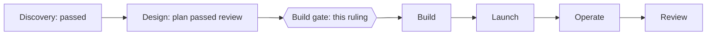
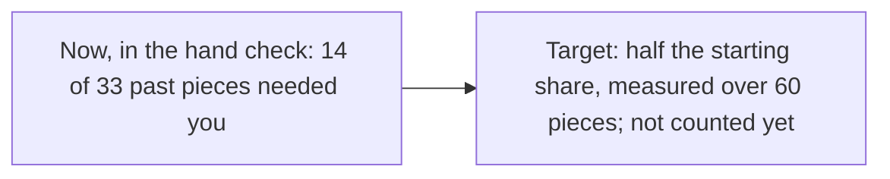
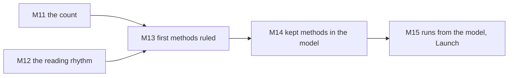
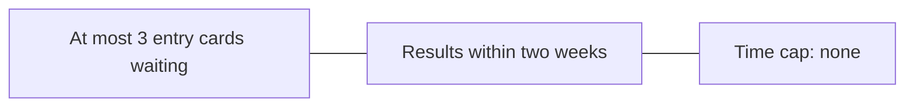

# P-002 — the Build gate

## 1. The ask

Approve the plan's 21 criteria as its scenarios give them, with the plan's additions to your look confirmation, and Build's and Launch's standard lines; the plan then freezes [docs/gates/P-002/build-gate-1-proposal.md] [reviews/S-002/plan.md:574] [docs/projects/P-002.md:131].

**The proposer's recommendation:** proceed — the plan passed review, its last changed lines passed their check, and the hand check of the counting rules ran [reviews/S-002/plan.md:1] [reviews/S-002/plan.md:709] [research/Q-018-memo-5.md:137].


*Text alternative: six phases in a row, Discovery, Design, Build, Launch, Operate and Review; Discovery passed its gate, Design's plan passed review, and the Build gate between Design and Build is this ruling.*
Where the screening stands [decisions/questions/P-002-design-gate.md] [reviews/S-002/plan.md:1]

## 2. The vision

Halve the share of pieces needing you, with the work holding up, checked 12 months after the first trial [docs/projects/P-002.md:192].
You approve each method before its trial and rule on it after [docs/projects/P-002.md:138].


*Text alternative: before and after. In the hand check, 14 of 33 past pieces needed you, 11 of 26 in its random part; the target is half the starting share over the 60 pieces before the first trial, which is not counted yet.*
The hand check's figure and the target [research/Q-018-memo-5.md:137] [research/Q-018-memo-5.md:138] [docs/projects/P-002.md:192]

## 3. What this phase taught us

Tried on past work, four counting rules proved wrong; they were corrected and re-coded [reviews/Q-018/critic.md] [research/Q-018-memo-5.md].
The touch log's keeper knows each piece's side, so by your ruling you confirm each look's conversation lines [decisions/questions/P-002-touch-log-check.md].
The join-up review found no blocking difference; its smaller ones were fixed [reviews/S-002/plan.md:311] [reviews/S-002/plan.md:346].

## 4. The plan for the next phase

Build's milestones: the count running, the reading rhythm, the first methods ruled, what you kept in the model [docs/projects/P-002.md:136] [docs/projects/P-002.md:137] [docs/projects/P-002.md:138] [docs/projects/P-002.md:139].
The Builder builds the count and the draw and runs each trial; the Reviewer judges each look [docs/projects/P-002.md:158] [docs/projects/P-002.md:163].
No dates are recorded [docs/projects/P-002.md:104].


*Text alternative: M11, the count, and M12, the reading rhythm, lead to M13, the first methods ruled; M13 leads to M14, kept methods in the operating model, then to M15 in Launch, the screening run from the operating model.*
How Build's milestones depend on each other [docs/projects/P-002.md:104]

## 5. The risks

A true halving shows only about 5 times in 10 [docs/projects/P-002.md:196].
Sides are known ahead, so work can be picked or folded; checks catch this in part, as stated limits [reviews/S-002/plan.md:599] [reviews/S-002/plan.md:642].
A fold into work naming no brief, begun after its entry, is not listed [reviews/S-002/plan.md:716].
A session knowing the sides can hold a look unjudged, changing no result [reviews/S-002/plan.md:584].
No trial starts until the desk keeps your confirmation, filed there for your approval [reviews/S-002/plan.md:578].

## 6. Cost and limits

The ceiling is your existing AI plan; no cap on your time [docs/projects/P-002.md:175] [docs/projects/P-002.md:176].
Each trial: two cards, then five short reads and a confirmation a look [docs/projects/P-002.md:197] [decisions/questions/P-002-touch-log-check.md].
Usage so far and your hours: not recorded [docs/projects/P-002.md:197].


*Text alternative: the limits on what reaches you: at most 3 entry cards wait at once, a results card reaches you within two weeks of a trial being judged, and there is no cap on your time.*
The limits you kept [docs/projects/P-002.md:176]

## 7. Kill criteria

A miss on the target at 12 months: you re-aim or close [docs/projects/P-002.md:196].
A starting count under 6 of 60 comes back to you; a summary after five trials [docs/gates/P-002/trial-terms.md:74] [docs/gates/P-002/trial-terms.md:75].
Look 1 failing the hold-up checks stops its trial [docs/gates/P-002/build-gate-1-proposal.md].

## 8. What the owner is agreeing to

The 21 criteria, frozen, with this plan's marked additions and stated limits [docs/gates/P-002/build-gate-1-proposal.md] [reviews/S-002/plan.md:574].
Your answers to the plan's open questions 2 to 9, on the gate card [reviews/S-002/plan.md:709].
Build's and Launch's standard lines, all taken on [docs/projects/P-002.md:131] [docs/projects/P-002.md:142].
You are the user: no user representative step [docs/projects/P-002.md:260].

## 9. Appendix: the phase record
<details>
<summary>The phase record</summary>

```milestones
```

The block is left as the gate check gives it for this project, run from a conversation, as at the Design gate; the table gives each milestone with its record [docs/gates/P-002/design-gate-2-case.md].

| Milestone | Record |
|---|---|
| Design-1 Done defined in real scenarios | The 21 criteria, reviewed with the plan [reviews/S-002/plan.md:1] [docs/gates/P-002/build-gate-1-proposal.md] |
| Design-2 How the pieces connect is mapped | The join sheets, checked side by side [reviews/S-002/plan.md:301] |
| Design-3 Every unknown has a test | Not recorded by the model; the hand check tested the counting rules on past work [research/Q-018-memo-5.md:137] |
| Design-4 Every fact is backed by evidence | Not recorded by the model; the plan's facts were read in its review rounds [reviews/S-002/plan.md:1] |
| Design-5 The design fits together | Not recorded by the model; the join-up review, no blocking difference [reviews/S-002/plan.md:311] |
| Design-6 A plan that passed review | Round 3 PASS, then two plan stops by your rulings, each closed by a passed check; the freeze follows this ruling [reviews/S-002/plan.md:1] [decisions/questions/P-002-plan-stop.md] [decisions/questions/P-002-plan-stop-2.md] |
| M8 Touches and reopenings can be counted | Rules written and hand-checked; reached at the freeze, for you to accept [research/Q-018-memo-5.md:137] [docs/projects/P-002.md:126] |
| M9 A fair trial is set down before any is run | The trial plan reviewed with S-002; reached at the freeze, for you to accept [reviews/S-002/plan.md:1] [docs/projects/P-002.md:127] |
| M10 The sources and how they are read are chosen | Feeds, rhythm and checks of outside code in the plan; reached at the freeze, for you to accept [reviews/S-002/plan.md:1] [docs/projects/P-002.md:128] |

Rulings in Design: the hand check's open points, the plan stops, every trial question counted, your confirmation of each look, and a piece's work read from its own files [decisions/questions/P-002-later-work-coder.md] [decisions/questions/P-002-live-later-work-check.md] [decisions/questions/P-002-touch-log-check.md] [decisions/questions/P-002-plan-written-by-piece.md] [decisions/questions/P-002-check-named-by-statement.md].

This plan's own additions to your confirmation ruling, marked in the plan for you here: the list shown without the sides, the unstrike check, a struck line not counting, the withdrawn-piece exception and the stop at look 1 [reviews/S-002/plan.md:574].

Words used. Piece: a merged pull request that changes built work, a plan or research [docs/projects/P-002.md:190].
Look: one of a trial's two planned points of judging [docs/gates/P-002/trial-terms.md].
Fold: a trial piece's work carried in a pull request with other work [reviews/S-002/plan.md:642].

</details>
