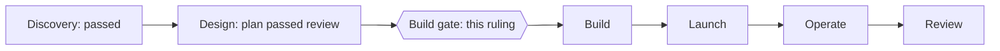
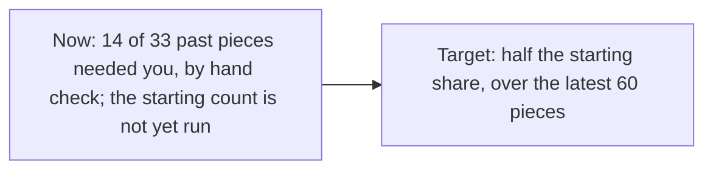

# P-002 — the Build gate

## 1. The ask

Approve the plan's twenty-one scenarios as written, with its own design and stated limits, and Build's and Launch's lines; the plan freezes once the terms card's answers are written in and checked [docs/gates/P-002/build-gate-1-proposal.md:17] [docs/projects/P-002.md:96].

**The proposer's recommendation:** proceed — the plan passed review, its last changes passed their check, and the join-up review found nothing blocking [reviews/S-002/plan.md:1] [reviews/S-002/plan.md:707] [reviews/S-002/plan.md:313]


*Text alternative: six phases in a row, Discovery, Design, Build, Launch, Operate and Review; Discovery passed its gate, Design's plan passed review, and the Build gate between Design and Build is this ruling.*
Where the screening stands in the six phases [decisions/questions/P-002-design-gate.md] [reviews/S-002/plan.md:1]

## 2. The vision

More work carried by agents end to end, trusted and holding up [decisions/questions/P-002-target.md].
Target: halve the share of pieces needing you, checked 12 months after the first trial [docs/projects/P-002.md:192].


*Text alternative: before and after. Now, the hand check found 14 of 33 past pieces needed at least one touch from you; the starting count over 60 pieces is not yet run. The target is half the starting share, over the latest 60 pieces.*
The hand check and the target [research/Q-018-memo-5.md:137] [docs/projects/P-002.md:192]

## 3. What this phase taught us

The counting rules work on records: 14 of 33 past pieces, 11 of 26 random, needed you [research/Q-018-memo-5.md:137] [research/Q-018-memo-5.md:138].
Conversation touches leave no record, so they are logged by hand, and you confirm them before each look [docs/gates/P-002/build-gate-1-proposal.md:21] [docs/gates/P-002/build-gate-1-proposal.md:25].
The join-up review found no blocking difference; four smaller ones are risks below [reviews/S-002/plan.md:313].
No screens [reviews/S-002/plan.md:302].

## 4. The plan for the next phase

The Check author writes locked checks; the Builder builds the count and the draw; the Reviewer tries to break them [docs/projects/P-002.md:157] [docs/projects/P-002.md:158].
Build's milestones: the count, the reading rhythm, the first trials, kept methods into the model [docs/projects/P-002.md:136] [docs/projects/P-002.md:139].
No trial before the freeze, the starting count, and the desk's record of your confirmations [docs/gates/P-002/build-gate-1-proposal.md:28].

## 5. The risks

Your design to approve: the confirmation shown without sides, your strikes, both looks listed, results worked both ways [docs/gates/P-002/build-gate-1-proposal.md:25].
Stated limits: sides known ahead, folded work listed or missed, a look held unjudged [reviews/S-002/plan.md:461] [reviews/S-002/plan.md:715] [reviews/S-002/plan.md:584].
Trial counts run a little high, toward a miss; the log's keeper knows the sides; the work is not blind [reviews/P-002-build-gate/critic.md:19] [reviews/P-002-build-gate/critic.md:20] [reviews/P-002-build-gate/critic.md:21].
The join-up review's four small differences [reviews/S-002/plan.md:313].
Trials may take months where work arrives slowly [docs/gates/P-002/build-gate-1-proposal.md:30].

## 6. Cost and limits

Your existing AI plan only; no cap on your time [docs/projects/P-002.md:175] [docs/projects/P-002.md:176].
Each trial: two cards and 5 short reads a look; usage so far not recorded [docs/projects/P-002.md:197].

## 7. Kill criteria

A miss at 12 months: you re-aim or close [docs/projects/P-002.md:196].
A trial stops on a failed first look, or when it breaks work you rely on [docs/gates/P-002/build-gate-1-proposal.md:27].

## 8. What the owner is agreeing to

The scenarios, frozen, with the plan's own design and limits [docs/gates/P-002/build-gate-1-proposal.md].
The terms card's answers: the plan's eight open questions and three smaller points [reviews/P-002-build-gate/critic.md:41].
Build's and Launch's standard lines, all taken on [docs/projects/P-002.md:131] [docs/projects/P-002.md:142].
Service Desk work keeping your confirmations, filed for you [docs/gates/P-002/build-gate-1-proposal.md:28].
You are the user: no user representative step [docs/projects/P-002.md:260].

## 9. Appendix: the phase record
<details>
<summary>The phase record</summary>

```milestones
```

</details>
