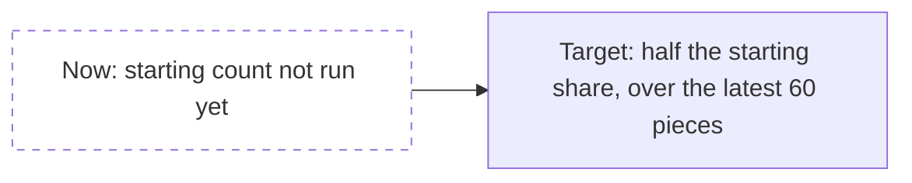
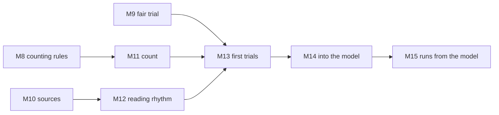
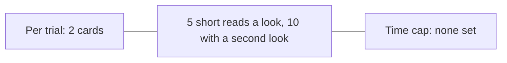

# P-002 — the Build gate

## 1. The ask

Case 2 answers the gate Critic's view of case 1 [reviews/P-002/_build-gate-1-critic.md].
The plan failed four reviews; at two plan stops you chose a focused fix, and it then passed [reviews/S-002/plan.md:6] [reviews/S-002/plan.md:340] [reviews/S-002/plan.md:545] [decisions/questions/P-002-plan-stop.md] [decisions/questions/P-002-plan-stop-2.md].
Approve its scenarios, own design, stated limits and Build's and Launch's lines [docs/gates/P-002/build-gate-2-proposal.md] [docs/projects/P-002.md:131].
It freezes once your terms answers are written in and checked [decisions/questions/P-001-build-gate.md:1] [decisions/questions/P-002-check-named-by-statement.md].

**The proposer's recommendation:** proceed — its last checks passed; the join-up review found nothing blocking [reviews/S-002/plan.md:1] [reviews/S-002/plan.md:707] [reviews/S-002/plan.md:313]


*Text alternative: six phases in a row, Discovery, Design, Build, Launch, Operate and Review; Discovery passed its gate, Design's plan passed review, and the Build gate between Design and Build is this ruling.*
Where the screening stands in the six phases [decisions/questions/P-002-design-gate.md] [reviews/S-002/plan.md:1]

## 2. The vision

More of your work carried by agents, trusted [decisions/questions/P-002-target.md].
Target: half the starting share of pieces needing you, checked 12 months after the first trial [docs/projects/P-002.md:192].


*Text alternative: before and after. Now, the starting count over 60 pieces is not run yet, drawn dashed as unknown; the target is half that starting share, over the latest 60 pieces.*
The starting figure and the target [docs/projects/P-002.md:192]

## 3. What this phase taught us

By hand, 14 of 33 past pieces needed you, 16 counting questions aimed at later work [research/Q-018-memo-5.md:137] [research/Q-018-memo-5.md:140].
Its re-read used each piece's own files, as you ruled [reviews/S-002/plan.md:723] [decisions/questions/P-002-check-named-by-statement.md].
Conversation touches are logged by hand; you confirm them [docs/gates/P-002/build-gate-2-proposal.md:21] [docs/gates/P-002/build-gate-2-proposal.md:25].
Join-up review: no blocking difference; no screens [reviews/S-002/plan.md:313] [reviews/S-002/plan.md:302].

## 4. The plan for the next phase

Locked checks first, then the Builder's count and draw, which the Reviewer tries to break [docs/projects/P-002.md:157] [docs/projects/P-002.md:158].
No trial before the freeze, the starting count and the desk's record [docs/gates/P-002/build-gate-2-proposal.md:28].


*Text alternative: M8, the counting rules, leads to M11, the count; M10, the sources, to M12, the reading rhythm; M9, the fair trial, M11 and M12 lead to M13, the first trials, then M14, kept methods into the operating model, then M15, the screening run from the model.*
How Build's milestones depend on Design's [docs/projects/P-002.md:104]

## 5. The risks

Trial counts run a little high: a lean toward a miss, not a bound [reviews/P-002-build-gate/critic.md:19] [reviews/P-002-build-gate/critic.md:92].
The log's keeper knows the sides, and the work is not blind; your confirmation and short reads guard in part [reviews/P-002-build-gate/critic.md:20] [reviews/P-002-build-gate/critic.md:21].
Sides known ahead, folded work listed or missed, a look held unjudged: stated on every card [reviews/S-002/plan.md:461] [reviews/S-002/plan.md:715] [reviews/S-002/plan.md:584].
Four small join-up differences stay open into Build [reviews/S-002/plan.md:308] [reviews/S-002/plan.md:311].
A kind needing over 26 weeks to its first look comes back to you [docs/gates/P-002/build-gate-2-proposal.md:30].

## 6. Cost and limits

Your existing AI plan only; no cap on your time; your hours are not recorded [docs/projects/P-002.md:175] [docs/projects/P-002.md:176] [docs/projects/P-002.md:197].


*Text alternative: your time per trial: an entry card and a results card, and 5 short reads of unlabelled pieces a look, 10 if it takes its second look; no cap on your time is set.*
Your time per trial [docs/projects/P-002.md:197] [docs/projects/P-002.md:176]

## 7. Kill criteria

A miss at 12 months: you re-aim or close; a real halving shows only about 5 times in 10, so a miss alone is weak evidence [docs/projects/P-002.md:196].
A trial stops on a failed first look, or if it breaks work you rely on [docs/gates/P-002/build-gate-2-proposal.md:27].

## 8. What the owner is agreeing to

The scenarios, frozen with the plan's design and limits [docs/gates/P-002/build-gate-2-proposal.md].
Your answers on the plan's eight open questions and three smaller points [reviews/P-002-build-gate/critic.md:41].
Build's and Launch's standard lines, all taken on [docs/projects/P-002.md:131] [docs/projects/P-002.md:142].
Service Desk work keeping your confirmations, filed for you [docs/gates/P-002/build-gate-2-proposal.md:28].
You are the user: no representative reads the proposal, despite its label [docs/projects/P-002.md:260].

## 9. Appendix: the phase record
<details>
<summary>The phase record</summary>

```milestones
```

The gate check prints no milestone lines for this project, run from a conversation, as at the Design gate; the table gives each Design milestone with its record [docs/gates/P-002/design-gate-2-case.md].

| Milestone | Record |
|---|---|
| Design-1 Done defined in real scenarios | The twenty-one scenarios, reviewed [reviews/S-002/plan.md:1] [docs/gates/P-002/build-gate-2-proposal.md] |
| Design-2 How the pieces connect is mapped | The join sheets J1 to J9, checked side by side [reviews/S-002/plan.md:303] |
| Design-3 Every unknown has a test | Not recorded by the model; the plan's tests for U1 to U5, reviewed [docs/projects/P-002.md:122] [reviews/S-002/plan.md:1] |
| Design-4 Every fact is backed by evidence | The plan's facts relied on, reviewed [reviews/S-002/plan.md:1] |
| Design-5 The design fits together | Not recorded by the model; the join-up review, no blocking difference [reviews/S-002/plan.md:313] |
| Design-6 A plan that passed review | FAIL at rounds 1 and 2, PASS at 3; FAIL at the re-check and at the re-run, each followed by your focused-fix ruling and a PASS; the last changes' check PASS; the freeze follows this ruling [reviews/S-002/plan.md:1] [reviews/S-002/plan.md:707] |
| M7 The odds behind the target hold up | Reached at the Design gate [docs/projects/P-002.md:117] |
| M8 Touches and reopenings can be counted | The rules and the hand check, reviewed; reached at the freeze [docs/projects/P-002.md:126] [research/Q-018-memo-5.md:137] |
| M9 A fair trial is set down before any is run | The trial design, reviewed; reached at the freeze [docs/projects/P-002.md:127] [reviews/S-002/plan.md:1] |
| M10 The screening's sources and how they are read are chosen | The sources and reading plan, reviewed; its done-when says "in the frozen plan", so reached at the freeze [docs/projects/P-002.md:128] [reviews/S-002/plan.md:1] |

Rulings in Design: the line at two looks, the hand check's open questions, the two plan stops, and how a piece's work is read [decisions/questions/P-002-two-look-line.md] [decisions/questions/P-002-plan-stop.md] [decisions/questions/P-002-plan-stop-2.md] [decisions/questions/P-002-plan-written-by-piece.md] [decisions/questions/P-002-check-named-by-statement.md].
Fixed after checks: the gate card, after one failed round [reviews/P-002-build-gate/critic.md]; case 1, by this case [reviews/P-002/_build-gate-1-critic.md].
The gate Critic's word count of case 1, about 430 by hand, differs from the gate check's, which passed it within 350 [reviews/P-002/_build-gate-1-critic.md:1].

</details>
