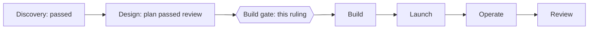
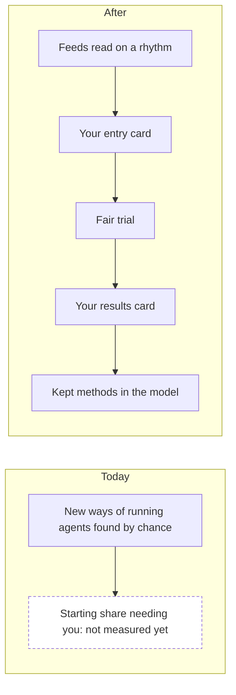
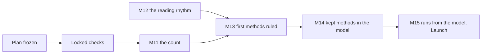
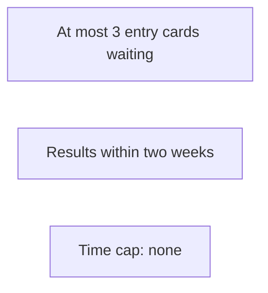

# P-002 — the Build gate

## 1. The ask

Case 1 was held; this answers it [reviews/P-002/_build-gate-1-critic.md].
Four counting rules proved wrong and were corrected; the plan failed three rounds before passing [reviews/Q-018/critic.md] [reviews/S-002/plan.md:1].
Approve the 21 criteria as the scenarios give them, with the plan's additions and the standard lines, and answer the open questions; the plan then freezes [docs/gates/P-002/build-gate-2-proposal.md] [decisions/questions/P-001-build-gate.md].
After it, changes need a new plan; the target is reversible until the first trial [docs/gates/P-002/trial-terms.md:65].

**The proposer's recommendation:** proceed — the plan passed review; today's ruling is written in and passed its check [reviews/S-002/plan.md:1] [reviews/S-002/plan.md:769] [research/Q-018-memo-5.md:137].


*Text alternative: six phases in a row, Discovery, Design, Build, Launch, Operate and Review; Discovery passed its gate, Design's plan passed review, and the Build gate between Design and Build is this ruling.*
Where the screening stands [decisions/questions/P-002-design-gate.md] [reviews/S-002/plan.md:1]

## 2. The vision

Halve the share of pieces needing you, the work holding up, checked 12 months after the first trial [docs/projects/P-002.md:192].


*Text alternative: today, new ways of running agents are found by chance, and the starting share of pieces needing you is not measured yet, drawn dashed as unknown; after, feeds are read on a rhythm, you approve a method on an entry card, a fair trial runs, you rule it on a results card, and kept methods enter the operating model.*
Your way of working today, against the change [docs/gates/P-002/design-gate-2-case.md] [docs/projects/P-002.md:192]

## 3. What this phase taught us

The hand check: 14 of 33 past pieces needed you, 16 of 33 without the later-work codes; several rules could not be tested [research/Q-018-memo-5.md:137] [research/Q-018-memo-5.md:140] [research/Q-018-memo-5.md:193].
The log's keeper knows the sides, so you confirm each look [decisions/questions/P-002-touch-log-check.md].
The join-up review found no blocking difference; the smaller ones were fixed [reviews/S-002/plan.md:311] [reviews/S-002/plan.md:347] [reviews/S-002/plan.md:351].

## 4. The plan for the next phase

Build: locked checks, then the count, the reading rhythm, methods ruled, kept methods in the model [docs/projects/P-002.md:131] [docs/projects/P-002.md:136] [docs/projects/P-002.md:139].
The Builder builds and runs; the Reviewer judges each look [docs/projects/P-002.md:158] [docs/projects/P-002.md:163].
No dates recorded [docs/projects/P-002.md:104].


*Text alternative: the frozen plan leads to the locked checks, then M11, the count; M11 and M12, the reading rhythm, lead to M13, the first methods ruled, then M14, kept methods in the model, then M15 in Launch.*
How Build's work depends on each other [docs/projects/P-002.md:104] [docs/projects/P-002.md:131]

## 5. The risks

Work of one kind may arrive slowly; past 26 weeks, it comes back to you [docs/projects/P-002.md:233] [docs/gates/P-002/build-gate-2-proposal.md].
A true halving shows about 5 times in 10, less once work must hold up [docs/projects/P-002.md:196].
Known sides let work be picked, held or folded; checks catch some [reviews/S-002/plan.md:599] [reviews/S-002/plan.md:668].
No trial on a kind the prompt engine is testing [docs/projects/P-002.md:198].
No trial until the desk keeps your confirmation [docs/projects/P-002.md:166].

## 6. Cost and limits

Your existing AI plan; no cap on your time [docs/projects/P-002.md:175] [docs/projects/P-002.md:176].
Each trial: two cards, then five short reads and a confirmation a look [docs/projects/P-002.md:197] [decisions/questions/P-002-touch-log-check.md].
Hours and usage so far: not recorded [docs/projects/P-002.md:197].


*Text alternative: the limits on what reaches you: at most 3 entry cards wait at once, a results card reaches you within two weeks of a trial being judged, and there is no cap on your time.*
The limits you kept [docs/projects/P-002.md:176]

## 7. Kill criteria

A miss at 12 months: you re-aim or close [docs/projects/P-002.md:196].
A starting count under 6 of 60 comes back to you; a summary after five trials [docs/projects/P-002.md:198].
Look 1 failing the hold-up checks stops its trial [docs/gates/P-002/build-gate-2-proposal.md].

## 8. What the owner is agreeing to

The 21 criteria, frozen after this ruling, with additions and limits [docs/gates/P-002/build-gate-2-proposal.md] [reviews/S-002/plan.md:574] [reviews/S-002/plan.md:575].
The target as ruled, tier T1, your existing AI plan as ceiling [docs/projects/P-002.md:192] [docs/projects/P-002.md:185] [docs/projects/P-002.md:175].
The trial line you ruled, 0.097 [decisions/questions/P-002-two-look-line.md].
Your answers to open questions 2 to 9, on the gate card [reviews/S-002/plan.md:771].
Build's and Launch's lines, all taken on [docs/projects/P-002.md:131] [reviews/P-002-standard-lines/critic.md].
You are the user: no user representative step [docs/projects/P-002.md:260].

## 9. Appendix: the phase record
<details>
<summary>The phase record</summary>

```milestones
```

The block is left as the gate check gives it for this project, run from a conversation, as at the Design gate; the table gives each milestone with its record [docs/gates/P-002/design-gate-2-case.md].

| Milestone | Record |
|---|---|
| Design-1 Done defined in real scenarios | The 21 criteria, reviewed with the plan [reviews/S-002/plan.md:1] [docs/gates/P-002/build-gate-2-proposal.md] |
| Design-2 How the pieces connect is mapped | The join sheets, checked side by side [reviews/S-002/plan.md:301] |
| Design-3 Every unknown has a test | Not recorded by the model; the hand check tested the counting rules (U1); U3 to U5 are tested in Build [research/Q-018-memo-5.md:137] [docs/projects/P-002.md:233] |
| Design-4 Every fact is backed by evidence | Not recorded by the model; the plan's facts were read in its review rounds [reviews/S-002/plan.md:1] |
| Design-5 The design fits together | Not recorded by the model; the join-up review, no blocking difference [reviews/S-002/plan.md:311] |
| Design-6 A plan that passed review | Passed; today's ruling written in and its check passed; the freeze follows this ruling [reviews/S-002/plan.md:1] [reviews/S-002/plan.md:769] |
| M8 Touches and reopenings can be counted | Rules written and hand-checked, today's ruling written in; for you to accept at the freeze [research/Q-018-memo-5.md:137] [reviews/S-002/plan.md:769] [docs/projects/P-002.md:126] |
| M9 A fair trial is set down before any is run | The trial plan reviewed with the plan; for you to accept at the freeze [reviews/S-002/plan.md:1] [docs/projects/P-002.md:127] |
| M10 The sources and how they are read are chosen | Feeds, rhythm and checks of outside code in the plan; for you to accept at the freeze [reviews/S-002/plan.md:1] [docs/projects/P-002.md:128] |

The hand check's limits: rules RT1(c), RT2(b), RT3(c), RT7's log part, RR1(b) and (c), and K4 untested on past records; no reopening seen; the first check undecided for 4 pieces and with no record for 9; 7 of the 33 drawn on purpose as awkward cases [research/Q-018-memo-5.md:193] [research/Q-018-memo-5.md:7] [research/Q-018-memo-5.md:138].

The plan's own additions to your confirmation ruling, each marked in the plan: the list shown without the sides; striking and unstriking, with the unstrike check; the withdrawn-piece exception; the stop at look 1; the Reviewer's check of the list and the log against the desk's record; counting a line only when a confirmed list holds it; the cut at the confirm line; results worked the other way; and the desk keeping your answer as a start condition [reviews/S-002/plan.md:574] [reviews/S-002/plan.md:575] [reviews/S-002/plan.md:674].

Limits stated in the plan: the Orchestrator, knowing the sides, picks when within 7 days to log a drop or start a withdrawal check; a look waits for an open spare place at most 60 days; touches naming other work in a folded piece still count on it; a fold into work naming no brief, begun after its entry, is not listed; a session knowing the sides can hold a look unjudged, changing no result [reviews/S-002/plan.md:507] [reviews/S-002/plan.md:512] [reviews/S-002/plan.md:620] [reviews/S-002/plan.md:716] [reviews/S-002/plan.md:584].

Two wording points from the last check are fixed before the freeze; neither changes a count [reviews/S-002/plan.md:775] [reviews/S-002/plan.md:781].

The freeze follows the ruling, as at the prompt engine's gate; the plan review's notes put it first, and this case follows the ruled precedent [decisions/questions/P-001-build-gate.md] [reviews/S-002/plan.md:536].

The proposal's label is the form's fixed line; no user representative read it [docs/projects/P-002.md:260].

Rulings in Design: the hand check's open points, the plan stops, every trial question counted, your confirmation of each look, and a piece's work read from its own files [decisions/questions/P-002-later-work-coder.md] [decisions/questions/P-002-plan-stop.md] [decisions/questions/P-002-plan-stop-2.md] [decisions/questions/P-002-live-later-work-check.md] [decisions/questions/P-002-touch-log-check.md] [decisions/questions/P-002-check-named-by-statement.md].

Words used. Piece: a merged pull request that changes built work, a plan or research [docs/projects/P-002.md:190].
Look: one of a trial's two planned points of judging [docs/gates/P-002/trial-terms.md].
Fold: a trial piece's work carried in a pull request with other work [reviews/S-002/plan.md:642].

</details>
