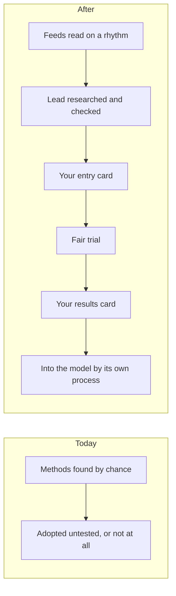
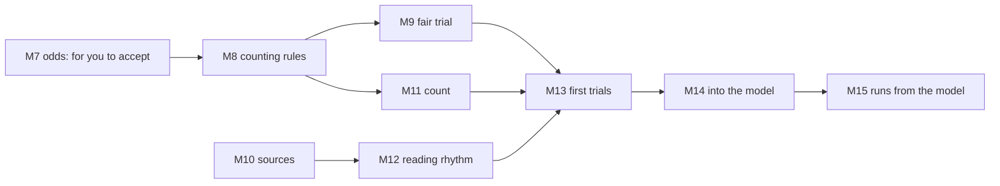

# P-002 — the Design gate

## 1. The ask

The brief failed its check three times; your focused last check passed it [reviews/P-002-brief/critic.md] [decisions/questions/P-002-brief-stop.md].
Move the screening into Design, where counting, trials and sources are written down before anything is counted or tried [docs/projects/P-002.md].
With it you rule the items in section 8 [docs/gates/P-002/trial-terms.md].

**The proposer's recommendation:** proceed — the brief passed, and the odds behind your target were reproduced independently [reviews/P-002-brief/critic.md] [reviews/P-002-value-target-odds/reviewer.md]


*Text alternative: six phases in a row, Discovery, Design, Build, Launch, Operate and Review; Discovery is done, and the Design gate between Discovery and Design is this ruling.*
Where the screening stands in the six phases [docs/projects/P-002.md]

## 2. The vision

More work carried by agents end to end, trusted and holding up [decisions/questions/P-002-target.md].
Target: halve the share of pieces needing you, checked 12 months after the first trial [docs/projects/P-002.md].
You approve each method before its trial and decide it after [decisions/questions/P-002-trial-gates.md].


*Text alternative: today, methods are found by chance and adopted untested or not at all; after, feeds are read on a rhythm, a lead is researched and checked, you approve it on an entry card, a fair trial runs, you rule it on a results card, and a kept method enters the operating model through its own change process.*
Your way of working today, against the change [docs/projects/P-002.md]

## 3. What this phase taught us

Re-tested outside claims held less often; copied code carried harm [docs/projects/P-002.md].
Small trials show only large gains; a true halving shows on the count about 5 times in 10 [docs/projects/P-002.md].
Your touches are not reliably recorded, and work of one kind arrives slowly [research/Q-017-memo.md].

## 4. The plan for the next phase

The Definer writes the counting rules, hand-checked on past pieces (M8), the trial (M9) and the sources (M10) into one plan; the Critic reviews it before it freezes [docs/projects/P-002.md].
No dates are recorded [docs/projects/P-002.md].


*Text alternative: M7, the odds, waits for you to accept it; M8, the counting rules, leads to M9, the fair trial, and to M11, the count; M10, the sources, leads to M12, the reading rhythm; M9, M11 and M12 lead to M13, the first trials, then M14, kept methods into the operating model, then M15, the screening run from the model.*
How the milestones depend on each other [docs/projects/P-002.md]

## 5. The risks

Touches uncountable: the hand check tests it; else they are logged by hand [docs/projects/P-002.md].
Too little work of one kind: you choose fewer kinds, a longer wait or a narrower target [docs/projects/P-002.md].
Clashing with the prompt engine: guards proposed [docs/gates/P-002/trial-terms.md].

## 6. Cost and limits

Spend and time ceilings: you set both now; until then, your existing AI plan [decisions/questions/P-002-groundwork-shortlist.md] [docs/projects/P-002.md].
Each trial costs you two cards and, as proposed, short reads [docs/gates/P-002/trial-terms.md].
Usage so far: not recorded [docs/projects/P-002.md].

## 7. Kill criteria

Proposed: a starting count under 6 of 60 comes back to you; a summary after five trials [docs/gates/P-002/trial-terms.md].
A miss at 12 months: you re-aim or close [docs/projects/P-002.md].

## 8. What the owner is agreeing to

Milestones M7 to M15, the standard lines, tier T1 and the intent [docs/projects/P-002.md].
The ceilings; each open unknown, U1 to U5, accepted or not [docs/projects/P-002.md].
The twenty proposals ruled, eight terms confirmed, and whether trials may start before the prompt engine finishes [docs/gates/P-002/trial-terms.md].
Whether M7 is reached [reviews/P-002-value-target-odds/reviewer.md].
You are the user: no user representative step [docs/projects/P-002.md].

## 9. Appendix: the phase record
<details>
<summary>The phase record</summary>

```milestones
```

The timeline prints no milestone lines for this project, whose Discovery ran from a conversation; the table gives each Discovery standard milestone with its record, and M7 with its state [docs/projects/P-002.md].

| Milestone | Record |
|---|---|
| Discovery-1 An idea worth exploring | Not recorded by the model; the brief notes the idea logged on 2026-10-15 and your ruling to start it beside the prompt engine [docs/projects/P-002.md] [decisions/questions/P-002-route.md] |
| Discovery-2 Success defined | Your rulings on the target and the two approvals [decisions/questions/P-002-value-target.md] [decisions/questions/P-002-trial-gates.md] |
| Discovery-3 The expert's questions answered | Your answers to the groundwork short list [decisions/questions/P-002-groundwork-shortlist.md] |
| Discovery-4 The right problem chosen | Your ruling on the aim; the problem statement passed the Critic at round 3 [decisions/questions/P-002-target.md] [reviews/P-002-problem-premortem/critic.md] |
| Discovery-5 What already exists is known | Research with source checks; where a last check failed, your rulings on what is relied on [decisions/questions/P-002-research-stop.md] [decisions/questions/P-002-research-stop-2.md] [decisions/questions/P-002-research-stop-3.md] [decisions/questions/P-002-q017-memo-stop.md] |
| Discovery-6 The risks are known | Not recorded by the model; the pre-mortem passed the Critic at round 3 [reviews/P-002-problem-premortem/critic.md] |
| Discovery-7 Scope, limits and owners agreed | Sections 1, 4 and 5 of the brief; the ceilings are yours at this gate [docs/projects/P-002.md] [decisions/questions/P-002-groundwork-shortlist.md] |
| Discovery-8 A brief ready to rule on | FAIL at rounds 1 to 3, your ruling for one focused check, PASS at round 4 [reviews/P-002-brief/critic.md] [decisions/questions/P-002-brief-stop.md] |
| M7 The odds behind the target hold up | The Reviewer's independent run: FAIL, FAIL, PASS; not reached until you accept it [reviews/P-002-value-target-odds/reviewer.md] |

Every trial term, marked ruled or proposed, with the two places the cards differ: the per-look or per-trial short reads, and the stop after a failed first look [docs/gates/P-002/trial-terms.md].

The brief's round 4 passed with five findings not fixed afterwards, so the passed text stands; each is carried here [reviews/P-002-brief/critic.md]:
- "Two cards per trial" sits in the brief's proposed list, though the two approvals are ruled; the list marks them ruled (T31) [docs/gates/P-002/trial-terms.md].
- The brief gives "its fixed trial plan" and "the Critic's view" to your design, though the card marked both as added by the Chief of Staff; the list marks them ruled, to confirm (T27, T28) [docs/gates/P-002/trial-terms.md].
- The brief says the intake files hold the cards as put; they hold your words and the short form shown, not the proposals, which only the cards at their commits hold [reviews/P-002-brief/critic.md].
- Pre-mortem R7 says "proposed" for the check of outside code, which your part 4 answer ruled (T10) [docs/gates/P-002/trial-terms.md].
- The Source checker's row does not say how outside text reaches it; outside text is read only by the Input reader, so Design (M10) sets this [docs/projects/P-002.md].

Open into Design, for you to accept or not: U1 to U5, each with a test and a fallback; none is accepted until your ruling is recorded [docs/projects/P-002.md].
</details>
